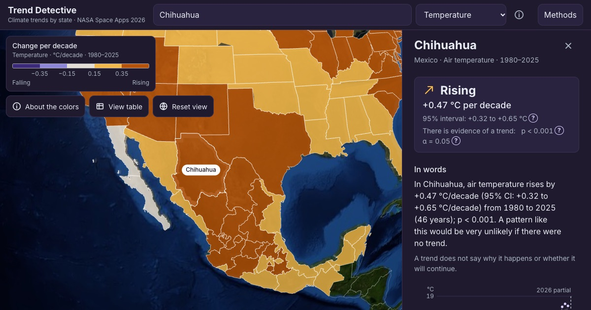

# Pedro

### [📄 View My Resume](https://pedroxionx.github.io/PedroxionX/)

---

## Featured Projects

### Trend Detective · NASA Space Apps Challenge 2026

Interactive web application for exploring trends across **14 environmental variables** in **84 regions of Mexico and the United States**, using NASA Earth science datasets. Combines a 3D globe, time-series visualization, regional comparisons, and statistical evidence with traceable data sources.

**React · TypeScript · Vite · Three.js · Earth Science Data**

[Live demo](https://trend-detective-ae.vercel.app/) · [Source code](https://github.com/PedroxionX/trend-detective-ae)

### HuellitasCare

Pet-care app for dog and cat owners, with symptom-based urgency guidance, offline pet histories and reminders, and access to verified veterinarians and nearby clinics. Helps owners decide when to seek veterinary care without diagnosing or prescribing treatment.

**Coming soon to iOS and Android.**

[Visit website](https://huellitascare.com/)

---

## Education

<table width="100%">
<tr>
<td>
<strong>Universidad Autónoma de Baja California (UABC)</strong> 
<em>B.Eng. in Software Engineering and Emerging Technologies</em> 
Currently enrolled · Highest education level
</td>
<td align="right">
Aug. 2022 – Jun. 2027 (Expected)
</td>
</tr>
</table>

**Software & Programming**

---

## Certifications

<table width="100%">
<tr>
<td>
<strong>Java (Basic)</strong> — HackerRank Skills Certification &nbsp;
 
Core Java: classes, data structures, inheritance, exception handling · Java 7 / Java 8
</td>
</tr>
<tr><td> </td></tr>
<tr>
<td>
<strong>Advanced Microsoldering and PCB Repair</strong> — Private Training Organization 
Microsoldering, PCB diagnostics, component-level repair, SMD/BGA replacement
</td>
</tr>
</table>

---

El CV y su despliegue se mantienen en este repositorio. Consulta la [guía de mantenimiento](docs/maintenance.md).
